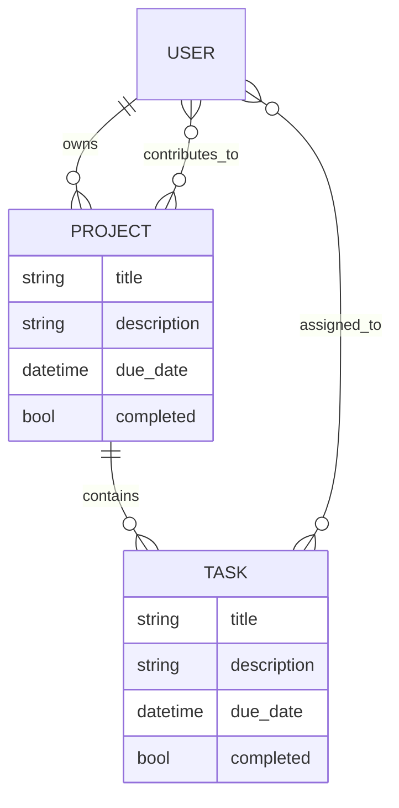

# GProj — Architecture

Technical reference for the GProj codebase. For the project pitch and run
instructions see [README.md](README.md); for sprint goals see
[PLANNING.md](PLANNING.md).

## Overview

GProj is a group-management web app for student collaboration on group projects.
It is a conventional server-rendered Django application:

| | |
|---|---|
| Framework | Django 6.0.8 |
| Language | Python 3.13 |
| Database | SQLite (local file) |
| Frontend | Django templates + Bootstrap 6 alpha via CDN |
| Auth | `django.contrib.auth` (default `User` model) |

There is **no** JavaScript build step, no REST API, no asset pipeline, and no
custom middleware. Every page is a full server-rendered HTML response. Adding a
feature means adding a URL, a view, and a template.

## Repository layout

```
Group-Management/
├── ARCHITECTURE.md CLAUDE.md README.md PLANNING.md
├── Makefile                      # `make run` → runserver
├── flake.nix / flake.lock        # Nix dev shell: python3 + django_6
├── .envrc                        # `use flake` (direnv auto-enters the shell)
└── group_management_app/         # ① Django PROJECT dir — holds manage.py
    ├── manage.py
    ├── db.sqlite3                # local only, gitignored
    ├── group_management_app/     # ② settings PACKAGE
    │   ├── settings.py
    │   ├── urls.py               #    root URLconf
    │   ├── wsgi.py / asgi.py
    │   └── __init__.py
    └── groupManagementApp/       # ③ the single Django APP — all features live here
        ├── models.py             #    Project, Task
        ├── views.py              #    5 function-based views
        ├── forms.py              #    ProjectForm, TaskForm
        ├── urls.py               #    app URLconf
        ├── admin.py              #    registers Project + Task
        ├── tests.py              #    access control + assignee tests
        ├── migrations/
        └── templates/
            ├── home.html
            ├── home/base.html    #    the one layout every page extends
            └── project/
                ├── project_list.html
                ├── add_project.html
                ├── view_project.html
                └── tasks/add_task.html
```

## Data model

Both models live in `groupManagementApp/models.py`. The app uses Django's default
user model, but refers to it indirectly via `settings.AUTH_USER_MODEL`, so
swapping in a custom user model later remains possible.



**`Project`** — `owner` (FK → User, `related_name="owned_projects"`, CASCADE),
`contributors` (M2M → User, `related_name="projects"`, blank), plus `title`,
`description`, `due_date`, `completed`.

**`Task`** — `project` (FK → Project, `related_name="tasks"`, CASCADE),
`assignees` (M2M → User, `related_name="tasks"`, blank), plus the same four
scalar fields.

Consequences worth knowing:

- A user's project membership is the **union** of `owned_projects` and
  `projects` — there is no single membership table. This is why the
  authorization helper below uses a `Q(...) | Q(...)` query.
- Deleting a user cascades away the projects they own, including other people's
  tasks inside them.
- `due_date` is required on both models; `completed` defaults to `False` and is
  deliberately excluded from both forms.
- `description` is a `CharField(max_length=1000)`, not a `TextField`, so the
  form renders a single-line input.

## URL map and request flow

The root URLconf (`group_management_app/urls.py`) mounts the app at `''` and the
Django admin at `admin/`. All application routes come from
`groupManagementApp/urls.py`:

| URL | View | Template | Login required |
|---|---|---|---|
| `home/` | `members` | `home.html` | no |
| `projects/` | `projects` | `project/project_list.html` | yes |
| `projects/add_project` | `add_project` | `project/add_project.html` | yes |
| `projects/<int:project_id>` | `project_view` | `project/view_project.html` | yes |
| `projects/<int:project_id>/add_task` | `add_task` | `project/tasks/add_task.html` | yes |

Note there is no route for `''` itself, so the site root returns 404 — the real
entry point is `/home/`. Templates must always resolve links through
`` rather than hardcoded paths.

The create views follow one shared shape — bind the form to `request.POST or
None`, so a GET renders empty and a POST validates in the same function:

```python
form = ProjectForm(request.POST or None)
if request.method == "POST" and form.is_valid():
    ...
    return redirect("project_view", project_id=project.pk)
return render(request, "...", {"form": form})
```

Both creates redirect to the project detail page on success (POST-redirect-GET).

## Authorization model

### Temporary Till User Auth System is Resolved

This is the most important design decision in the codebase, and the pattern to
copy for any new project-scoped view.

`views.py` defines a single helper:

```python
def user_projects(user):
    return Project.objects.filter(Q(owner=user) | Q(contributors=user)).distinct()
```

Views that take a `project_id` then resolve it **through that queryset**:

```python
project = get_object_or_404(user_projects(request.user), pk=project_id)
```

Scoping the queryset rather than fetching the object and then checking ownership
means a non-member receives a **404, not a 403** — they cannot distinguish "not
mine" from "does not exist", so project IDs can't be probed by enumeration. It
also makes the authorization impossible to forget: there is no code path that
loads a project without filtering it. `.distinct()` is required because the M2M
join can otherwise return duplicate rows.

A second layer guards the task form. `TaskForm.__init__` accepts a `project`
kwarg and narrows the assignee choices to that project's members only:

```python
self.fields["assignees"].queryset = User.objects.filter(
    Q(pk=project.owner_id) | Q(projects=project)
).distinct()
```

Because Django validates `ModelMultipleChoiceField` against this queryset on
submit, this is real enforcement rather than a UI nicety — a tampered POST naming
an outside user fails validation. **Always pass `project=` when constructing
`TaskForm`**; omitting it silently falls back to all users.

## Forms

`groupManagementApp/forms.py` holds two `ModelForm`s. Both omit `completed` so it
takes its model default, and both declare their Bootstrap classes and
`datetime-local` inputs in `Meta.widgets` — styling lives in the form, not the
template, which is why templates can loop generically over fields.

`add_task` saves with `commit=False` to attach the parent project, which defers
many-to-many handling, so it must call `form.save_m2m()` afterward or the
selected assignees are silently dropped.

## Templates

`APP_DIRS=True` and `TEMPLATES['DIRS']` is empty, so every template resolves from
`groupManagementApp/templates/`. All pages extend `home/base.html`, which holds
the `<head>`, the Bootstrap CDN link, the navbar, and a single
`` inside `<main class="container py-4">`.

Form templates share one idiom — iterate fields, render label, widget, and
errors, and include ``:

```django

  <div class="mb-3">
    <label class="form-label">{{ field.label }}:</label>
    {{ field }}
    <div class="text-danger">{{ error }}</div>
  </div>

```

## Development environment

Dependencies are managed per person, but **Nix** can be used.
`flake.nix` pins nixpkgs to `nixos-26.05` and provides `python3` plus `python313Packages.django_6`; `.envrc` contains `use flake`, so direnv enters the shell automatically on `cd`.

```bash
direnv allow                                   # or: nix develop
make run                                       # → runserver on :8000
python group_management_app/manage.py migrate   # build local db.sqlite3
python group_management_app/manage.py createsuperuser
```

All `manage.py` commands are run from the repo root with the
`group_management_app/` prefix, matching the `Makefile`.

`db.sqlite3` is **not** in version control — each contributor builds their own by
running `migrate`. Migrations themselves *are* committed, so everyone shares one
schema history; run `makemigrations` after changing `models.py` and commit the
result.

## Planned / not yet built

Carried forward from the original architecture notes and `PLANNING.md` Sprint 1:

| Feature | Status |
|---|---|
| User authentication / registration | **Deferred** — scaffolding present, routes not wired (see below) |
| Project board interface (workflow columns) | Not started — detail page is a flat list |
| Planner / calendar + due-date views | Not started — `due_date` is stored but only displayed |
| Notifications | Not started — no email or in-app delivery |
| Account management menu | Not started |
| Home / project menu navigation | Navbar is still Bootstrap placeholder markup |
| Task completion toggle | `completed` field exists on both models; no UI sets it |
| Contributor invite flow | No view adds to `Project.contributors` — only via `/admin/` |
| Labels for tasks and ideas | Not started — no model |

## Known issues and gotchas

- **Authentication is not usable yet.** Four views carry `@login_required`, but
  neither URLconf includes `django.contrib.auth.urls`, and `LOGIN_URL` /
  `LOGIN_REDIRECT_URL` are unset. An anonymous request to `/projects/` therefore
  redirects to `/accounts/login/`, which 404s. Workaround for now: log in at
  `/admin/` to obtain a session. The fix when auth lands is
  `path("accounts/", include("django.contrib.auth.urls"))` plus login/signup
  templates.
- **`MAILERS` in `settings.py` is not a Django setting.** Django reads
  `EMAIL_BACKEND`; as written the console email backend is inert. Rename it when
  notifications are implemented.
- **`DEBUG = True`, a literal committed `SECRET_KEY`, and an empty
  `ALLOWED_HOSTS`.** Fine for coursework, all three must change before any
  deployment.
- **`.envrc` is listed in `.gitignore` but is already tracked**, so the ignore
  rule has no effect on it. Harmless; `git rm --cached .envrc` would resolve it.
- **Navbar is unmodified Bootstrap boilerplate** — "Navbar" brand, `href="#"`
  links, and a search form wired to nothing.
- **Bootstrap is pinned to `6.0.0-alpha.1` from a CDN**, so there is no offline
  development and the alpha may introduce breaking changes.
